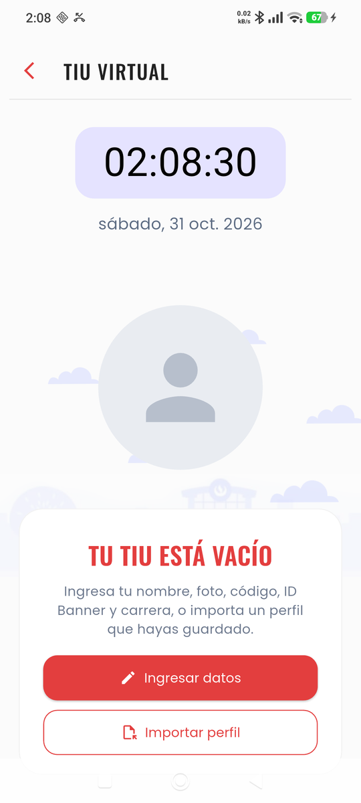

# UPC TIU Virtual (AppFakeUPC)

App Android hecha en Flutter que muestra un **TIU virtual** (Tarjeta de Identificación Universitaria) con tu nombre, foto, código de alumno, ID Banner, carrera y campus, junto con un reloj en vivo. Arranca en menos de un segundo y abre directamente en el TIU con tus datos guardados.

> **Uso responsable.** Es un proyecto personal y **no oficial**: no está afiliado ni respaldado por la UPC y no reemplaza tu credencial oficial. Úsala siempre con **tus propios datos reales**. No la uses para hacerte pasar por otra persona ni para engañar a nadie.

<p align="center">
  
</p>

## Contenido

- [Características](#características)
- [Instalación en el celular](#instalación-en-el-celular)
- [Primer uso](#primer-uso)
- [Perfiles: guardar, exportar e importar](#perfiles-guardar-exportar-e-importar)
- [Desarrollo](#desarrollo)
- [Estructura del proyecto](#estructura-del-proyecto)
- [Rendimiento del arranque](#rendimiento-del-arranque)
- [Solución de problemas](#solución-de-problemas)
- [Créditos y licencias](#créditos-y-licencias)

## Características

- **TIU completo desde el primer cuadro:** al abrir la app ves el TIU ya cargado (datos, foto y fuentes), sin pantallas de carga intermedias.
- **Reloj y fecha en vivo**, en español (por ejemplo, `sábado, 31 oct. 2026`).
- **Sin datos de fábrica:** la APK no trae datos de nadie. La primera vez te pide nombre, foto, código, ID Banner y carrera (el campus es opcional).
- **Perfiles:** guarda varios perfiles, cámbialos con un toque y expórtalos o impórtalos como archivo `.upctiu.json` con la foto incluida.
- **Funciona sin internet:** las fuentes van dentro de la app y nada se descarga al usarla.

## Instalación en el celular

**Requisitos:** Android 7.0 o superior. La app no se publica en tiendas, así que hay que instalar el APK a mano.

### 1. Conseguir el APK

Compílalo siguiendo [Desarrollo](#desarrollo) o pídeselo a quien lo compiló. Hay un APK por tipo de procesador:

| Archivo | Para |
| --- | --- |
| `app-arm64-v8a-release.apk` | La gran mayoría de celulares actuales (**usa este si no sabes cuál**) |
| `app-armeabi-v7a-release.apk` | Celulares antiguos de 32 bits |
| `app-x86_64-release.apk` | Emuladores y equipos x86 |
| `app-release.apk` | Universal (sirve en todos, pero pesa casi el triple) |

### 2a. Instalar desde el propio celular

1. Copia el APK al celular (por cable, Drive, WhatsApp, etc.).
2. Ábrelo desde la app **Archivos** y toca **Instalar**.
3. Si Android lo bloquea, permite **Instalar apps desconocidas** para la app con la que lo abriste. Android suele ofrecerte el ajuste en el mismo aviso.

### 2b. Instalar por USB con ADB

1. Activa **Opciones de desarrollador** (toca 7 veces "Número de compilación") y luego **Depuración USB**.
2. En Xiaomi, Redmi o POCO (MIUI/HyperOS) activa también **Instalar vía USB** en Opciones de desarrollador.
3. Conecta el celular, acepta la huella de depuración y ejecuta:

```bash
adb install -r app-arm64-v8a-release.apk
```

El `-r` actualiza la app **conservando tus datos**. En Xiaomi aparece un aviso en el teléfono que tienes que aceptar en pocos segundos; si no, falla con `INSTALL_FAILED_USER_RESTRICTED`.

### Actualizar a una versión nueva

Instala el APK nuevo encima del anterior (paso 2a o `adb install -r`). Tus datos y perfiles se mantienen **siempre que el APK esté firmado con la misma clave**. Si Android dice que la app "no es compatible" o que hay un conflicto de firma, mira [Solución de problemas](#solución-de-problemas) antes de desinstalar nada.

## Primer uso

1. Abre la app. Verás **TU TIU ESTÁ VACÍO**.
2. Toca **Ingresar datos** y completa nombre, código de alumno, ID Banner y carrera. El campus es opcional.
3. Toca el círculo de la cámara para elegir tu foto de la galería.
4. Ajusta el tamaño de los textos si quieres y toca **APLICAR AL TIU VIRTUAL**.

Si ya tienes un perfil exportado, toca **Importar perfil** y elige el archivo `.upctiu.json`: el TIU queda listo al instante.

Para volver a editar, toca la **flecha roja (‹)** arriba a la izquierda del TIU. Se abre **Personalizar TIU**.

## Perfiles: guardar, exportar e importar

En **Personalizar TIU**, toca el ícono de **marcadores** (arriba a la derecha):

| Acción | Cómo |
| --- | --- |
| Guardar el perfil actual | **Guardar datos actuales como perfil** y ponle un nombre |
| Cargar un perfil | Toca el perfil en la lista y luego **APLICAR AL TIU VIRTUAL** |
| Exportar un perfil | Ícono de descarga junto al perfil y elige dónde guardarlo |
| Exportar todos | **Exportar todos** |
| Importar | **Importar** y elige un archivo `.upctiu.json` |
| Eliminar un perfil | Ícono de papelera junto al perfil |
| Dejar el TIU vacío | **Borrar datos del TIU** al final del formulario (no borra los perfiles guardados) |

> **Haz una copia de seguridad.** Los datos viven solo dentro de la app: si la desinstalas, se pierden. Exporta tus perfiles y guarda el archivo en Drive o en tu PC antes de desinstalar o cambiar de celular.

### Formato del archivo `.upctiu.json`

Es un JSON legible. La foto va incrustada en base64, así que el archivo funciona en cualquier celular:

```json
{
  "app": "upctiu",
  "version": 1,
  "perfiles": [
    {
      "nombrePerfil": "Principal",
      "nombre": "NOMBRE APELLIDO",
      "codigo": "202312345",
      "idBanner": "N00000000",
      "carrera": "INGENIERÍA DE SOFTWARE",
      "campus": "Campus San Miguel",
      "nameSize": 32.0,
      "descSize": 18.0,
      "foto": "<imagen JPG en base64, opcional>"
    }
  ]
}
```

El archivo contiene datos personales (foto y códigos): no lo publiques. La carpeta `mis_datos/` del repositorio está en `.gitignore` justamente para guardar ahí tus perfiles sin subirlos a GitHub.

## Desarrollo

### Requisitos

| Herramienta | Versión probada | Notas |
| --- | --- | --- |
| Flutter | 3.47.8 (stable), Dart 3.13 | [Instalar Flutter](https://docs.flutter.dev/get-started/install) |
| JDK | 17 o 21 | **No uses JDK 25**: Gradle 8.14 no lo soporta |
| Android SDK | API 36 | Se instala con Android Studio (SDK Manager) |
| Android Studio | Cualquiera reciente | Con los plugins de Flutter y Dart |

Configuración del proyecto Android: Gradle 8.14.3, Android Gradle Plugin 8.13.0, Kotlin 2.2.20, `minSdk` 24.

### Preparar el entorno (una sola vez)

```bash
git clone https://github.com/Rendery/AppFakeUPC.git
```

```bash
cd AppFakeUPC/UPCTiu
```

Si tu JDK por defecto es el 25 (el que trae Android Studio reciente), indícale a Flutter un JDK 17 o 21:

```bash
flutter config --jdk-dir "C:\Program Files\Java\jdk-21"
```

Acepta las licencias del SDK de Android y revisa que todo esté en verde:

```bash
flutter doctor --android-licenses
```

```bash
flutter doctor
```

En Android Studio abre la carpeta **`UPCTiu`** (no la raíz del repositorio) y en *Settings → Languages & Frameworks → Flutter* apunta al SDK de Flutter. Si compilas desde Android Studio, en *Settings → Build, Execution, Deployment → Build Tools → Gradle* elige también un **Gradle JDK** 17 o 21.

### Comandos habituales

Todos se ejecutan dentro de `UPCTiu/`.

| Para | Comando |
| --- | --- |
| Descargar dependencias | `flutter pub get` |
| Ejecutar en modo debug (hot reload) | `flutter run` |
| Ejecutar en modo release | `flutter run --release` |
| Análisis estático | `flutter analyze` |
| Tests | `flutter test` |
| Compilar los APK de release | `flutter build apk --release --split-per-abi` |

Los APK quedan en `UPCTiu/build/app/outputs/flutter-apk/`.

> El modo debug siempre arranca lento. Para juzgar la velocidad de arranque usa **release**.

> **Ojo con `flutter run` en un celular con datos.** Si la instalación falla, `flutter run` **desinstala la app y reintenta**, y eso borra los datos guardados. En un celular con perfiles que te importan, compila con `flutter build apk` e instala con `adb install -r`, que nunca desinstala.

### Firma

Por ahora la build de release se firma con la **clave de debug** de cada PC (`signingConfig signingConfigs.debug` en `android/app/build.gradle`). Por eso un APK compilado en otra computadora no se instala encima del anterior. Para distribuir la app a varias personas conviene crear una clave de release propia ([guía oficial](https://docs.flutter.dev/deployment/android#sign-the-app)) y usarla siempre.

## Estructura del proyecto

```
AppFakeUPC/
├── README.md
├── docs/                      # Imágenes de esta guía
├── mis_datos/                 # Tus perfiles exportados (ignorado por git)
└── UPCTiu/                    # Proyecto Flutter
    ├── lib/
    │   ├── main.dart              # Arranque: lee los datos y retiene el splash hasta que el TIU está listo
    │   ├── vista_tiu.dart         # Pantalla del TIU: reloj, nubes animadas, estado vacío
    │   ├── vista_configuracion.dart  # "Personalizar TIU": formulario y gestor de perfiles
    │   ├── perfil.dart            # Modelo Perfil, almacenamiento y exportar/importar
    │   └── fuentes.dart           # Estilo de texto Oswald (fuente variable)
    ├── assets/
    │   ├── fonts/                 # Poppins y Oswald empaquetadas
    │   ├── arbolito.png
    │   └── cloud.png
    ├── android/                   # Proyecto Android (splash, Gradle, manifest)
    └── test/widget_test.dart      # Tests de pantalla, perfiles y formato de fecha
```

Los datos se guardan con `shared_preferences` y las fotos se copian a la carpeta de documentos de la app. Los archivos se exportan e importan con `file_picker`, que usa el selector de archivos del sistema.

## Rendimiento del arranque

La app está optimizada para que lo primero que veas sea el TIU completo:

- **Una sola espera antes de dibujar:** leer los datos guardados (3-5 ms).
- **Splash retenido hasta el final:** el splash nativo se mantiene hasta que la foto, el árbol y las nubes están decodificados (máximo 400 ms). Así el primer cuadro ya es el TIU completo.
- **Fuentes declaradas en `pubspec.yaml`:** el motor las registra al iniciar, sin cargas asíncronas ni cambio de letra.
- **Fecha sin `intl`:** se formatea a mano y no se cargan los datos de todos los idiomas.
- **Fotos al tamaño mostrado:** se decodifican a 175 dp y se reducen a 800 px al elegirlas de la galería.
- **Redibujado mínimo:** el reloj y las nubes se redibujan solos, sin tocar el resto de la pantalla.
- **Splash del color del TIU:** el fondo de Android usa el mismo color del TIU, sin destellos ni en modo oscuro.

Medido en un Redmi Note 14 (HyperOS 3, Android 16), el arranque en frío hasta ver el TIU completo tarda unos **0,85 s**. Casi todo ese tiempo es de Android y del motor de Flutter. Para medirlo en tu equipo:

```bash
adb shell am force-stop com.example.upctiu
```

```bash
adb shell am start -W -n com.example.upctiu/.MainActivity
```

Fíjate en `TotalTime` (milisegundos).

## Solución de problemas

**`Gradle build failed due to Java/Gradle incompatibility`.** Flutter está usando JDK 25. Configura uno 17 o 21 con `flutter config --jdk-dir` (ver [Preparar el entorno](#preparar-el-entorno-una-sola-vez)).

**`INSTALL_FAILED_USER_RESTRICTED: Install canceled by user`.** Pasa en Xiaomi, Redmi y POCO. Activa **Instalar vía USB** en Opciones de desarrollador y acepta el aviso que aparece en el teléfono al instalar. Si sigue fallando, copia el APK al celular e instálalo desde Archivos.

**`INSTALL_FAILED_UPDATE_INCOMPATIBLE` o "conflicto de firma".** El APK nuevo está firmado con otra clave (por ejemplo, se compiló en otra PC). Para instalarlo hay que desinstalar la app, y eso **borra tus datos**. Antes, exporta tus perfiles y luego vuelve a importarlos.

**Gradle o Flutter avisan que AGP 8.13 o Kotlin 2.2.20 "dejarán de tener soporte pronto".** Es solo un aviso y la app compila igual. La próxima actualización del proyecto Android debería pasar a AGP 9 y Kotlin 2.3.20 o superiores.

**Mensajes de Kotlin `this and base files have different roots` al compilar.** Aparecen cuando el proyecto y la caché de paquetes de Flutter están en discos distintos (por ejemplo, `E:` y `C:`). Son inofensivos: la compilación termina bien.

**`Building with plugins requires symlink support` en Windows.** Solo afecta a las builds de escritorio para Windows. Para Android puedes ignorarlo, o activar el Modo de desarrollador de Windows para que desaparezca.

## Créditos y licencias

- Fuentes [Poppins](https://fonts.google.com/specimen/Poppins) y [Oswald](https://fonts.google.com/specimen/Oswald), tomadas del repositorio [google/fonts](https://github.com/google/fonts) y distribuidas bajo la [SIL Open Font License 1.1](https://openfontlicense.org).
- Hecha con [Flutter](https://flutter.dev).
